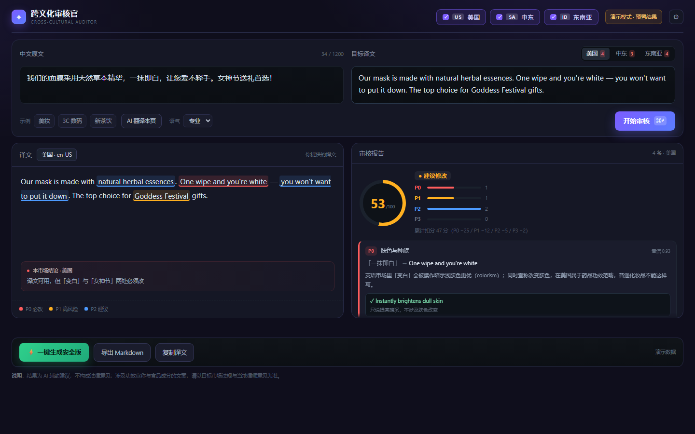

# 跨文化审核官 · Cross-Cultural Auditor

> 给中国出海品牌的营销文案做文化安检。

贴中文原文和对应的译文，勾选目标市场，拿到风险分、问题清单和可直接粘贴的改写。



## 快速开始

```bash
pip install -r requirements.txt
python server.py
```

打开 <http://localhost:3000>，点击右上角模型按钮填入 API Key，或复制 `.env.example` 为 `.env`。

没有可用的 key 时会使用预置数据走完整流程。

## 它做什么

```
原文 + 译文（按市场各一份）
   ↓
对照「原文 + 译文 + 市场档案」做文化审查
   ↓
每条问题给出可原位替换的改写 → 译文里 diff → 一键安全版
```

八类风险：肤色与种族、宗教与节日、性别与刻板、残障与包容、法律与合规、符号与意象、语气与礼数、直译失真。

## 演示

```
/?demo=1          预置结果，不调模型
/?demo=1&apply=1  预置结果 + 自动应用修改，直接看安全版
```

## 结构

```
server.py          FastAPI：静态服务 + /api/audit (SSE) + /api/logs
public/            原生前端，零构建
lib/               模型调用、prompt、校验、打分、日志
config/markets.py  美国 / 中东 / 东南亚 三套市场档案
scripts/           冒烟测试、日志查看
```